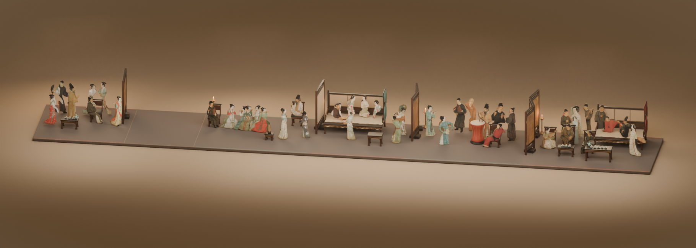
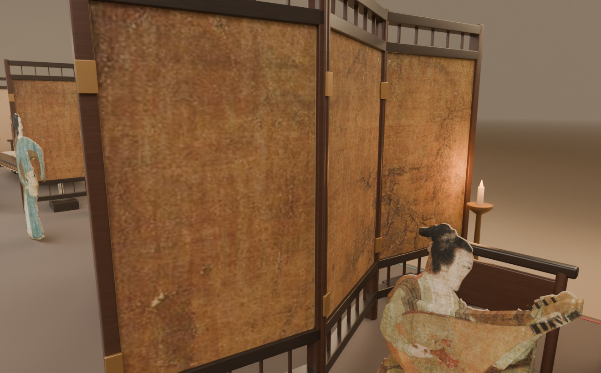
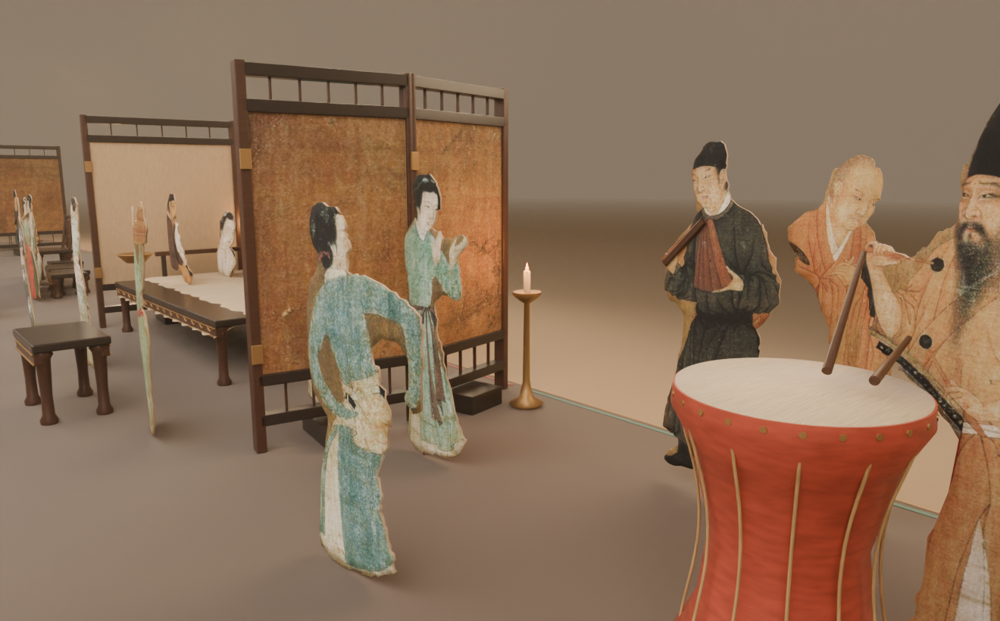
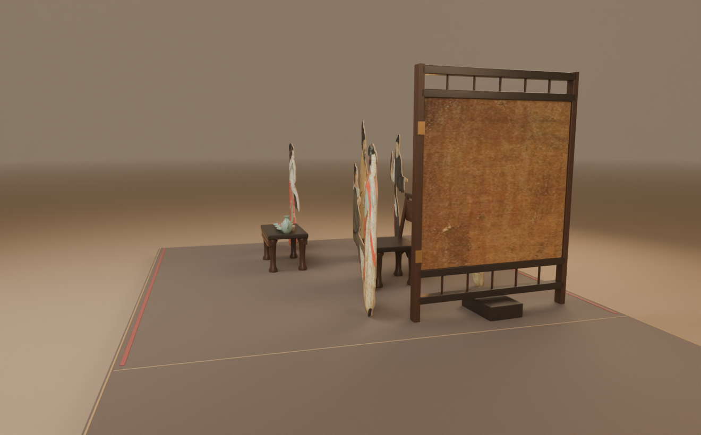
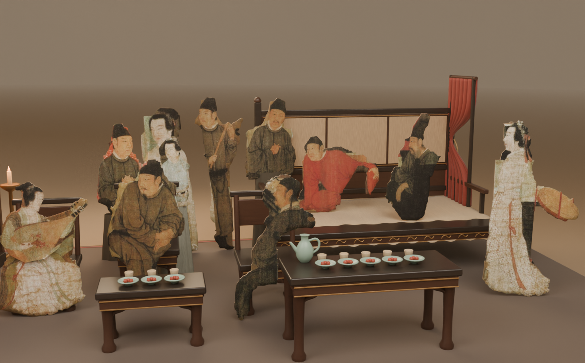
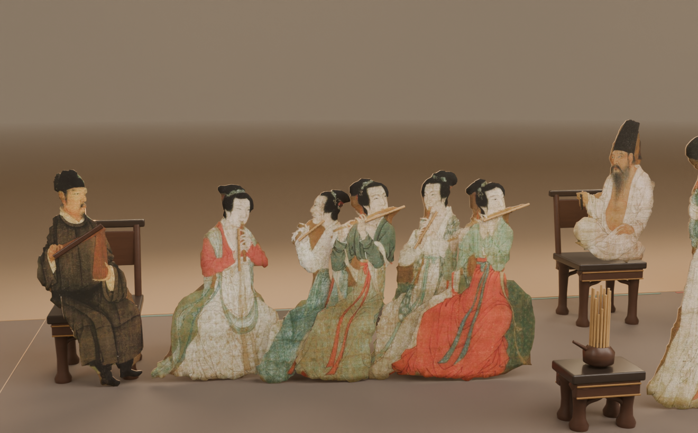
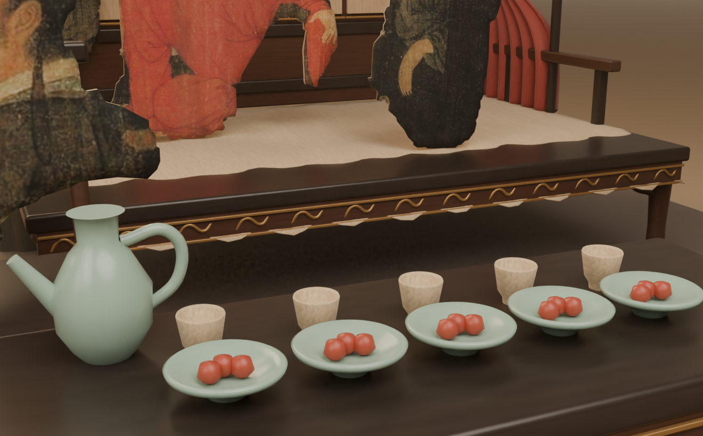

# 韩熙载夜宴图 · 立体折屏画卷

**GPT-6 Astra 实际使用体验测试**　｜　执行模型 GPT-6.2 Astra　｜　Blender 5.2.4 LTS　｜　中国叙事手卷的事件进程与虚拟空间设计

从右侧入卷。先在听乐的折屏前站定，再沿屏端绕行，击鼓者与舞者才重新进入视野。抵达清吹与散宴之间时，事件的转换交给一段 3.30 米长的空地。这个可编辑的 Blender 工程把手卷的观看顺序转成一项可以测量和改变的空间实验。



**[下载可编辑工程](scene/night-revels.blend)** · [场景说明与证据](docs/场景与证据.md) · [完整测试提示词](docs/提示词原文.txt) · [测量报告](docs/measurements.json) · [素材与许可](docs/素材与许可.md)

## 先看两个切片

| 听乐 → 观舞，屏前驻足 | 从前缘绕开折屏 |
|---|---|
|  |  |
| 第 25 帧，眼高 1.59 m | 第 49 帧，眼高 1.59 m |



第 73 帧观察第二个切片。与前一个需要绕开的屏障相比，这里的行进方向保持连续，时间来自两组人物之间的距离。

## 打开与操作

1. 安装 Blender 5.2.4 LTS，在新目录执行下面的克隆命令。工程文件和底本随常规 Git 下载，无需 Git LFS。
2. 从 Blender 的 **File → Open** 打开 `scene/night-revels.blend`。原图已打包。顶部渲染菜单 **Render → Render Image** 可出当前机位的 Cycles 图像。
3. 时间轴的 **1 / 25 / 49 / 73 / 97 / 121 / 145** 帧依次绑定总览、屏前、绕屏、留白、听乐、清吹、案头。数字小键盘 **0** 切换相机视图。
4. 在 Outliner 展开 **Characters** 下的分段集合，选中姓名对应的 Empty 可移动整张人物画片。在子网格的 Edit Mode 可改轮廓、浮雕面和 UV。**Screens** 下每组屏的木框、格棂、屏足、铰链和画心分别可选。需要试移整组屏时，从相应集合选择对象并整体变换。
5. 关闭 **Lights** 集合中的“烛雾场”可比较散射对屏后可见度的影响。选中人物、家具或器物，在自定义属性里查看 `depth_band`；从 1 到 5 是由近及远的五带。

```sh
git clone https://github.com/w399651114-oss/night-revels-folding-screen.git
cd night-revels-folding-screen
```

## 从脚本重建

以下命令在仓库根目录执行。macOS 使用官方应用包内的 Blender。Linux 可将第一行改为 `BLENDER=blender`。Windows PowerShell 可用 `& "C:\Program Files\Blender Foundation\Blender 5.2\blender.exe"` 替换每行的 `"$BLENDER"`。构建进程使用干净的启动场景，输出另存至 `build/`。打开和常规重建均可离线执行，无需 MCP、模型账号或额外 Python 包。

```sh
BLENDER="/Applications/Blender.app/Contents/MacOS/Blender"

"$BLENDER" --factory-startup -b --python-exit-code 1 -P scripts/build.py -- --out build/night-revels.blend
"$BLENDER" --factory-startup -b build/night-revels.blend --python-exit-code 1 -P scripts/validate_scene.py -- --report build/measurements.json --compare docs/measurements.json
"$BLENDER" --factory-startup -b build/night-revels.blend --python-exit-code 1 -P scripts/render.py -- --out build/renders --samples 24
```

只看空间骨架可在构建命令末尾加 `--stage-only`，并为骨架提供单独的输出文件名。快速检查两个切片，可在渲染命令后加 `--views 2,3,4 --percent 50 --samples 4`。提交的渲染使用 Cycles、固定种子 963、24 采样与降噪。硬件和降噪器版本可能影响像素。

## 建模实现与可运行功能

| 操作 | 实现与可检查结果 |
|---|---|
| 将人物从底本拆出并重新布置 | 每位人物都有手描边界、原图坐标及初始姿态。轮廓内部约束三角剖分后，原图笔墨直接映射到轻微起伏的正面。43 个角色实例，含 5 次韩熙载；正面共 20,250 个三角形。 |
| 观察器物和家具近景 | 可分别编辑琵琶面板与弦轴、羯鼓鼓皮与系绳、拍板、横笛、筚篥类纵管、十七管笙、酒盏内膛、执壶提梁、围榻雕饰与帷帐褶线。 |
| 进行真人尺度试验 | 舞台 29.40 × 4.40 m，四组屏障高 2.20 m，实体进深 3.304 m。屏前和屏侧有独立视线检查。按全部实体的最前沿计算，全长连续净宽下界为 0.920 m。 |
| 检验坐姿与支承 | 对榻上人物沿竖直方向寻找局部支承面，调节绢面底边。验收脚本检查人物画片和家具求值后表面的三角形相交，当前结果为 0。 |
| 独立修改材质与构造 | 877 个对象、20 种使用中材质、7 台相机。木纹、绢帛经纬、旧铜、漆器、釉面、烛雾均可在节点内调整。完整计数按对象与集合统计。 |

| 听乐与床榻 | 清吹合奏 |
|---|---|
|  |  |



## 底本证据与推定边界

故宫藏南宋摹本提供五段顺序、人物正面姿态、可见持物和器具局部。长宽、段间距离、屏风背面、五带深度、座具隐面、烛光与雾均为设计推定。笙是独立陈列的器物补型。对照表按事件列出可从画上指出的 L1 证据、馆方释读以及本工程的空间推定。[场景与证据](docs/场景与证据.md) · [故宫著录](https://www.dpm.org.cn/collection/paint/228200.html)

## 实测中暴露的不足

- 人物保留原卷姿态，极侧视角可见绢片边缘与素色背面。原本被他人遮住的手臂和衣袖只有部分轮廓，近距离放大也会看到拼接图的分辨率上限。四处推定下裳可以单独选择。
- 乐器的管孔、簧管数、鼓体剖面、家具榫接和人物身高均缺乏实测依据。纵管种属及笙的原卷位置仍有不确定性。
- 七台机位可以比较遮挡、留白与近景。人物固定在既定姿态，工程未制作骨骼动画、布料动力学或碰撞导航。家具相交测试的覆盖范围见说明文档。
- 本次测试曾生成外轮廓存在而内部没有面的模型。检查实际渲染后，修正了轮廓绕序，并为每件人物加入面数断言。另一处父级变换错误导致琵琶面板偏离持物位置，已修复并以全场边界校验覆盖。

## 文件与复现边界

| 路径 | 内容 |
|---|---|
| `scene/` | 已打包底本的可编辑 Blender 工程 |
| `assets/` | 原卷 JPG、手描种子边界、已细化的人物折线与姿态数据 |
| `scripts/build.py` | 组织集合、屏障、光照、材质、机位、打包与保存 |
| `scripts/ensemble.py`、`scripts/textiles.py` | 人物配准、器物、家具几何、裱绢、衣褶与落座定位 |
| `scripts/trace.py` | 可选的原图轮廓再提取 |
| `scripts/validate_scene.py`、`scripts/render.py` | 尺度、交叉、视线、几何指纹验证与批量渲染 |
| `docs/`、`renders/` | 提示词、研究说明、素材来源、实测数据及真实 Blender 渲染图 |
| `SHA256SUMS`、`.github/workflows/` | 发布资源校验与基础 CI |

常规重建使用仓库内的轮廓。若要重做抠像，可另建 Python 3.12 环境，安装 `numpy==2.5.5`、`opencv-python-headless==5.1.0.95`，从根目录执行 `python scripts/trace.py`。该操作覆盖 `assets/figures.json`。修改角色走位时，先调整 `tracings.txt` 的姿态并重新生成 JSON；清吹合奏的压叠间距、就坐微调和人物持物配准在 `ensemble.py` 中。Blender 文件保存元数据随路径变化，因此重建比较使用对象变换、网格、UV 和曲线的几何指纹。预制文件本身另有 SHA-256 校验。

公开仓库包含打开和重建成品所需的全部工程资产。软件安装包、用户配置、试渲染、编译缓存、运行日志和中间克隆只留在制作机。项目使用 Blender 内置界面字体，场景无外部字体依赖。[素材来源与许可](docs/素材与许可.md)
