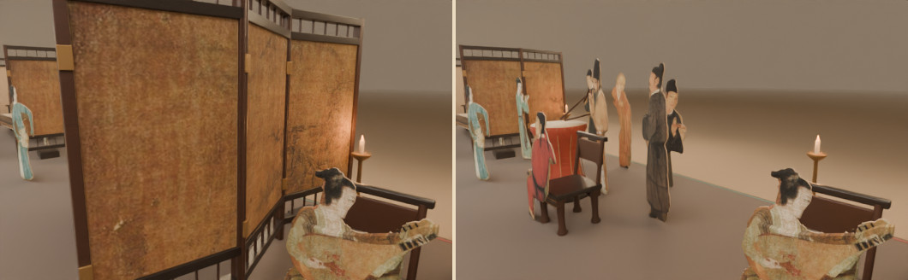
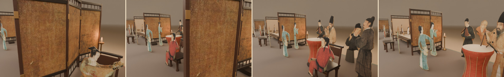
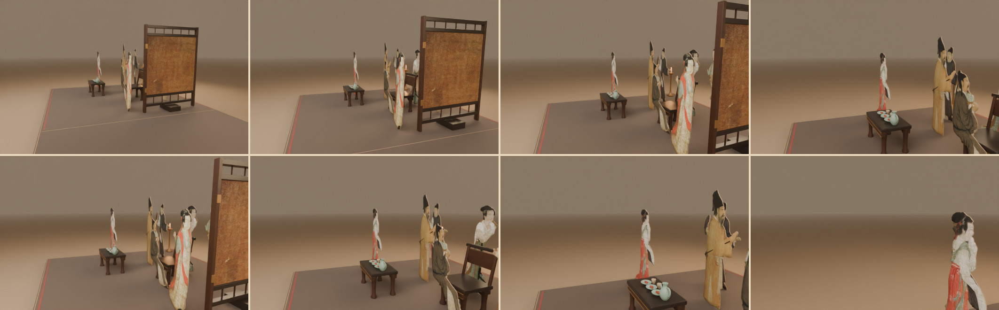
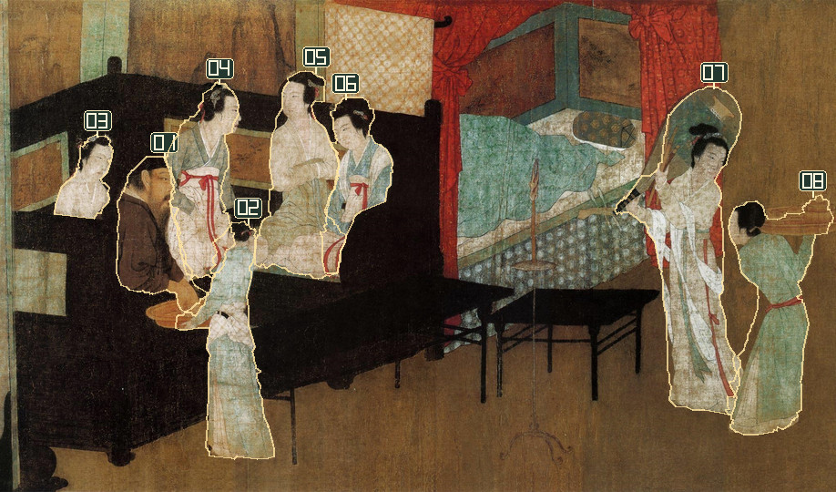
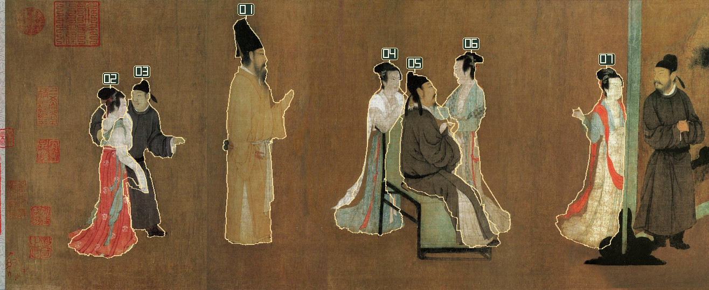
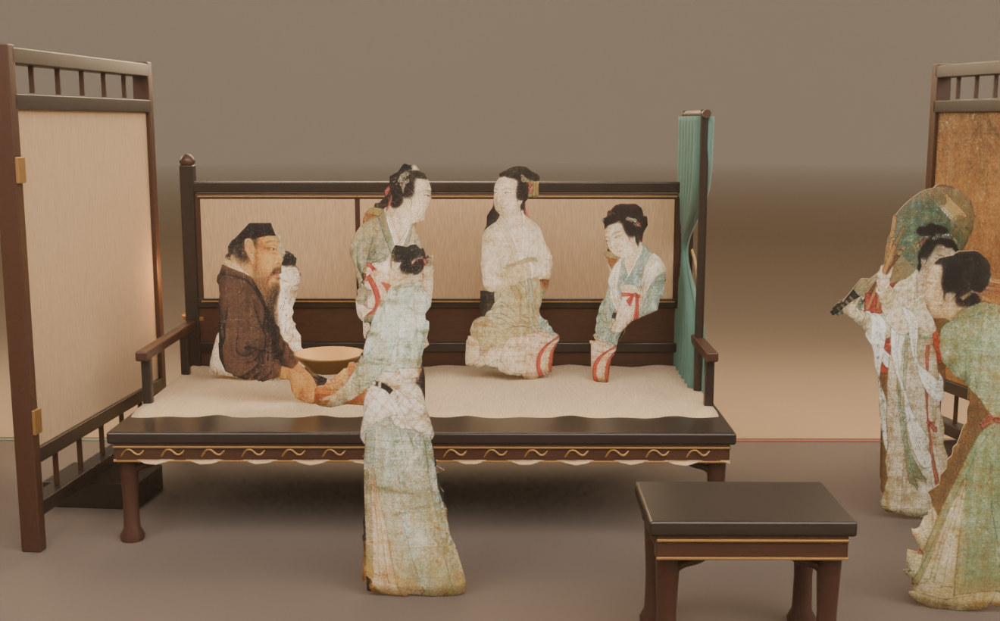
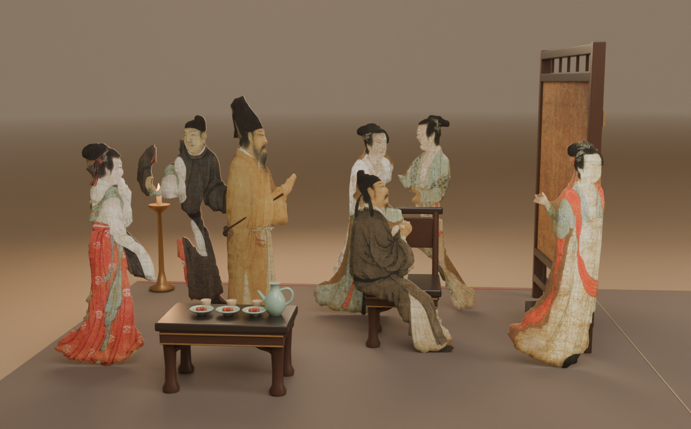

# 屏障遮住谁，留白延迟了什么

两项实验用同一份宋摹本人物轮廓、Blender 5.2.4 LTS、固定种子 963、五个景深带和 24 fps。主工程沿 −X 展卷，舞台为 29.40 × 4.40 米。短廊用作对照，舞台为 27.20 × 4.40 米。时间轴里前九台相机供定点阅读，最后两台相机有可以修改的线性关键帧。选中相机后可在 Dope Sheet 调整时间。

## 听乐 → 观舞

早期说明把舞者当成完全藏在屏后的人。将第 25 帧的相机、人物和灯光锁定，只开关第一组折屏，便能直接定位遮挡对象。下图左侧保留屏，右侧隐藏屏。观察原来位于屏左缘的青衣舞者，再找右图鼓旁的长髯主人。



| 定点 | 王屋山，有屏 / 隐屏 | 击鼓的韩熙载，有屏 / 隐屏 |
|---|---:|---:|
| 第 25 帧，屏前 | 623 / 623 | 0 / 599 |
| 第 49 帧，绕屏后 | 2740 / 2740 | 4003 / 4003 |

表中数值为 330 × 205 个射线样点中首先触及目标人物彩墨表面的数量。完整画幅以 1320∶820 构图，射线取每格的中心。纳入地台、屏、人物、家具、器物与接缝的求值后几何。雾、投影、纹理色差与观看者视力不参与计算。遮挡试验维持人物间和人物与其他器物间的相互遮挡。



从左至右是第 217、239、267、313 帧。同一台 26 mm 相机从屏前沿外缘移动，眼高 1.59 米。第 239 帧首次命中击鼓者。最初几条射线只能说明局部露出。定点第 25、49 帧使用各自原有的 25、27 mm 镜头，两张固定机位图也保留在 README 中。验证脚本逐帧取行走中心线和障碍物的保守包围框，并检查舞台边缘余量。两条轨迹均可容纳半径 0.25 米、高 1.82 米的直立试验截面。这个简化截面没有转肩或步态模型。

## 清吹 → 散宴

长、短两案从同一点出发，向 −X 以 1 m/s 前进 5 秒。镜头 27 mm、眼高 1.59 米、Y = −1.70 米、朝向和焦距完全相同。出发点 X = −6.55 米，清吹结束线 X = −7.05 米。短案把散宴人物、家具、手持物、灯、出口座屏和段界整体前移 2.20 米，并从卷尾裁短同样长度。其余四段保持原位。脚本配对检查了两个场景里 847 件屏风、人物、家具、器物与照明对象的世界坐标或包围范围。

| 从第 337 帧出发计时 | 主案，留白 3.30 米 | 对照，留白 1.10 米 |
|---|---:|---:|
| 散宴主人首次有样点可见 | 第 337 帧，0 秒，139 点 | 第 337 帧，0 秒，482 点 |
| 越过清吹结束线，进入净空 | 第 349 帧，0.50 秒 | 第 349 帧，0.50 秒 |
| 主人可见面积首次达 508 点，约占画幅 0.75% | 第 391 帧，2.250 秒 | 第 340 帧，0.125 秒 |
| 越过留白出口，进入散宴 | 3.80 秒，首个越线采样为第 429 帧 | 1.60 秒，首个越线采样为第 376 帧 |
| 在净空内的连续行走时间 | 3.30 秒 | 1.10 秒 |



四列自左至右为第 337、365、391、429 帧。两案里，观看点都能在离开清吹前瞥见散宴主人。变短的留白使观者提早 2.20 秒抵达下一段，人物在视野中占据较大面积的时刻也提前。508 点是供复算的几何阈值。若只要求一个命中，两个方案的结果都是起点已经可见。若提高到 677 点，主案和短案分别在第 399 和 346 帧首次达到。人物身份被人辨认的时刻需要另外采集受试者数据。

每份 CSV 有 218 行样本，其中绕屏 97 帧、穿廊 121 帧。跨越界线的时间按实际位移连续计算，CSV 中的第一帧越线样本取整到下一帧。逐帧结果、第一组屏的开关实验和不同阈值均可下载。[主案 CSV](data/walk-3.30.csv) · [短案 CSV](data/walk-1.10.csv) · [主案摘要](data/walk-3.30.json) · [短案摘要](data/walk-1.10.json)

## 暂歇和散宴回到底本

| 暂歇净手 | 散宴送客 |
|---|---|
|  |  |
|  |  |

暂歇可从韩熙载的伸手、盆沿和侍女的手核对净手关系。散宴可从持槌者与分组交谈的客、伎核对姿态与朝向。段内图上的轮廓可按编号找回 Blender 操作柄和画片网格。D01–D08 逐件给出折屏、乐器、净手盆和持物的画面位置。画面可见关系列为 L1。屏背、厚度、实体隔断位置、乐器细部及两种廊长均为 H。笙另作陈列补型。[人物与器物定位图集](底本定位.md)

## Astra 迭代记录

| 检查时发现的问题 | 本次处理及可复查结果 |
|---|---|
| 第一版人物只有边界，正面未正确填充 | 调整剖分绕序。对 43 张画片逐件断言有效面与 UV，正面总计 20,250 个三角面。 |
| 琵琶面板曾因父级变换偏移 | 对应原图位置生成面板、补偿人物父级变换，并检查场景边界。 |
| 原工程拖动击鼓者时，两根鼓槌留在原地 | 保持两根槌的初始世界变换，把它们挂在击鼓者操作柄下。回归测试将主人沿 X 平移 0.50 米，修订前两槌各移动 0 米，修订后各移动 0.50 米，鼓座移动 0 米。验证后恢复原位。 |
| 旧说明把舞者写成被折屏完全遮挡的对象 | 在同一帧切换整组屏的渲染可见性，并与目标逐点射线对照。保留原构图，修订叙述。 |
| 原留白实验只有单幅定点画面和长度换算 | 新增两种可打开的工程、同轨迹播放、逐帧 CSV、九处定点视图和真实渲染对照。 |

参考《入画·汴京》公开记录实际画面、提示词、复跑入口和不足的方式。本工程的交付和行走实验均在 Blender 内完成。[参考项目固定版本](https://github.com/Rising1234Sun/qingmingshanghetu/tree/056909af652421b50b9a775aa334fb49a1804398) · [制作提示词原文](提示词原文.txt)

## 重新生成图版

`bash scripts/reproduce.sh` 复建两案并输出数据和冒烟渲染。下列命令复绘图版本身。在仓库根目录设置 `BLENDER` 指向 Blender 可执行文件。图版排版另需 Python 3 和 Pillow 13.0.0，编号笔画由脚本绘制。

```sh
BLENDER="/Applications/Blender.app/Contents/MacOS/Blender"
"$BLENDER" --factory-startup -b scene/night-revels.blend --python-exit-code 1 -P scripts/render.py -- --out build/plates/main --frames 25,217,239,267,313,337,365,391,429 --percent 40 --samples 12
"$BLENDER" --factory-startup -b scene/night-revels.blend --python-exit-code 1 -P scripts/render.py -- --out build/plates/off --frames 25 --omit-first-screen --percent 40 --samples 12
"$BLENDER" --factory-startup -b scene/gap-control.blend --python-exit-code 1 -P scripts/render.py -- --out build/plates/control --frames 337,365,391,429 --percent 40 --samples 12
python3 -m venv build/plate-env
build/plate-env/bin/python -m pip install Pillow==13.0.0
build/plate-env/bin/python scripts/plates.py --frames build/plates --out build/figure-book/plates
```

命令将底本图集、对象索引和并排图输出到 `build/figure-book/`。仅重绘底本编号时，可省略三个 Blender 命令及 `--frames`。
