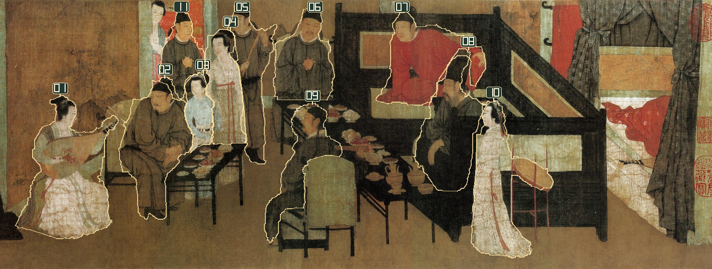
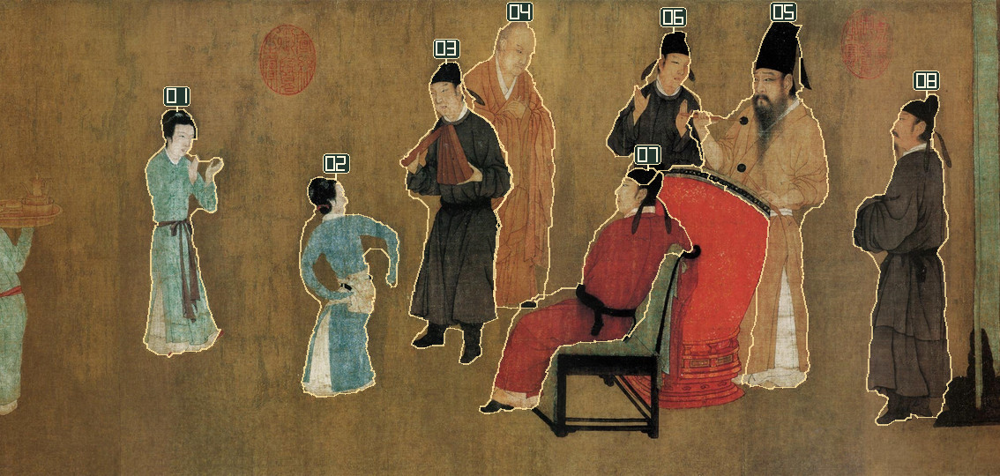
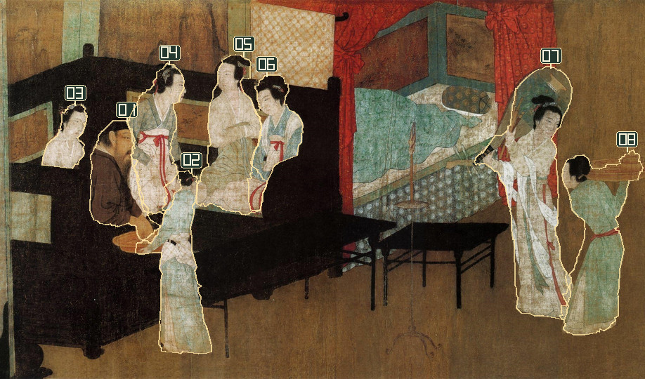
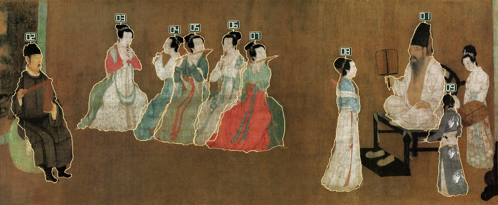
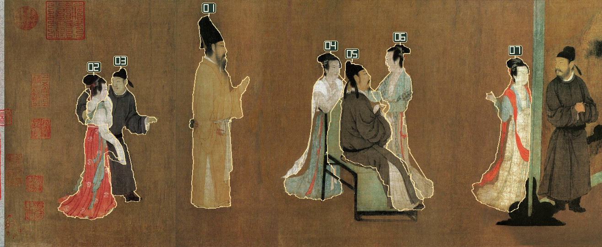

# 底本定位索引

坐标以仓库原图左上为原点，统一换算到 4633 × 400。人物轮廓收在 figures.json，ID 与姓名的固定映射收在 figure-ids.json。在 Blender 的 Outliner 搜索姓名，选中人物操作柄或彩墨浅浮雕即可读到相同的 source_id。段内图上的两位数对应 F 后的编号。轮廓记录当前数字描摹边界，贴近重叠处时应放大原卷核对。

## 第 1 段 · 听乐

取景 X 为 3580–4633。相邻人物可进入取景边缘。

| 稳定编号 | 人物操作柄 | 底本轮廓框 x₀, y₀ → x₁, y₁ |
|---|---|---|
| S1-F01 | 李家明妹·侧坐弹琵琶 | 3602.3, 142.7 → 3755.3, 354.7 |
| S1-F02 | 李家明·向乐伎侧听 | 3755.3, 115.0 → 3865.6, 325.7 |
| S1-F03 | 小侍·听乐 | 3852.9, 108.3 → 3897.6, 226.7 |
| S1-F04 | 白衣侍女·屏下 | 3883.3, 44.0 → 3944.3, 214.7 |
| S1-F05 | 执杖宾客 | 3916.3, 4.0 → 3990.3, 243.7 |
| S1-F06 | 青衣宾客·拱手 | 3984.0, 8.7 → 4075.0, 148.7 |
| S1-F07 | 郎粲·红袍盘坐 | 4136.0, 17.7 → 4299.0, 156.0 |
| S1-F08 | 韩熙载·听乐 | 4192.3, 73.3 → 4300.6, 284.0 |
| S1-F09 | 背坐宾客·席前 | 3970.6, 154.0 → 4086.3, 360.3 |
| S1-F10 | 执扇侍女 | 4276.3, 149.0 → 4398.6, 383.3 |
| S1-F11 | 近屏青衣宾客 | 3814.3, 15.0 → 3883.3, 148.7 |

## 第 2 段 · 观舞

取景 X 为 2750–3590。相邻人物可进入取景边缘。

| 稳定编号 | 人物操作柄 | 底本轮廓框 x₀, y₀ → x₁, y₁ |
|---|---|---|
| S2-F01 | 击掌侍女 | 2870.5, 92.3 → 2937.9, 299.3 |
| S2-F02 | 王屋山·六幺舞 | 3001.5, 149.0 → 3085.6, 333.0 |
| S2-F03 | 拍板乐人 | 3085.9, 52.3 → 3180.2, 305.7 |
| S2-F04 | 德明·背立 | 3138.2, 16.3 → 3216.2, 259.0 |
| S2-F05 | 韩熙载·击鼓 | 3326.9, 15.7 → 3446.2, 326.3 |
| S2-F06 | 持杖随从 | 3259.2, 26.0 → 3347.2, 155.3 |
| S2-F07 | 红衣观者·后倚 | 3152.2, 141.7 → 3331.9, 347.0 |
| S2-F08 | 拱手宾客 | 3465.6, 79.3 → 3549.6, 356.3 |

## 第 3 段 · 暂歇

取景 X 为 2115–2795。相邻人物可进入取景边缘。

| 稳定编号 | 人物操作柄 | 底本轮廓框 x₀, y₀ → x₁, y₁ |
|---|---|---|
| S3-F01 | 韩熙载·净手 | 2209.2, 127.7 → 2283.8, 256.3 |
| S3-F02 | 递盆侍女 | 2257.8, 180.7 → 2338.5, 373.0 |
| S3-F03 | 榻上侍女·一 | 2158.8, 109.7 → 2207.2, 177.7 |
| S3-F04 | 榻上侍女·二 | 2249.5, 67.3 → 2309.5, 225.7 |
| S3-F05 | 榻上侍女·三 | 2321.8, 58.0 → 2396.5, 226.3 |
| S3-F06 | 榻上侍女·四 | 2375.2, 79.3 → 2434.8, 222.0 |
| S3-F07 | 执团扇侍女 | 2614.5, 70.7 → 2718.2, 337.0 |
| S3-F08 | 捧盘侍女 | 2704.9, 158.7 → 2793.2, 353.0 |

## 第 4 段 · 清吹

取景 X 为 1000–1970。相邻人物可进入取景边缘。

| 稳定编号 | 人物操作柄 | 底本轮廓框 x₀, y₀ → x₁, y₁ |
|---|---|---|
| S4-F01 | 韩熙载·敞衣盘坐 | 1748.1, 43.7 → 1868.1, 255.3 |
| S4-F02 | 执拍板者 | 1021.1, 84.0 → 1142.4, 356.0 |
| S4-F03 | 清吹一·纵管 | 1150.7, 47.0 → 1288.4, 257.0 |
| S4-F04 | 清吹二·纵管 | 1259.4, 69.7 → 1361.1, 274.0 |
| S4-F05 | 清吹三·横笛 | 1299.8, 65.7 → 1414.1, 282.3 |
| S4-F06 | 清吹四·纵管 | 1378.1, 60.3 → 1481.4, 284.0 |
| S4-F07 | 清吹五·横笛 | 1400.1, 81.7 → 1555.4, 297.7 |
| S4-F08 | 侍立听候 | 1626.1, 112.0 → 1706.1, 373.7 |
| S4-F09 | 榻侧立侍 | 1830.5, 182.3 → 1912.5, 382.3 |

## 第 5 段 · 散宴

取景 X 为 0–975。相邻人物可进入取景边缘。

| 稳定编号 | 人物操作柄 | 底本轮廓框 x₀, y₀ → x₁, y₁ |
|---|---|---|
| S5-F01 | 韩熙载·持槌送客 | 306.0, 24.7 → 404.4, 337.7 |
| S5-F02 | 红裙舞伎·回身 | 93.3, 120.3 → 204.3, 355.7 |
| S5-F03 | 揖别宾客 | 122.3, 110.0 → 254.4, 326.7 |
| S5-F04 | 后席侍女 | 459.7, 85.7 → 561.4, 325.0 |
| S5-F05 | 坐客·回首 | 549.4, 98.7 → 688.4, 341.3 |
| S5-F06 | 对席侍女 | 601.4, 71.7 → 702.1, 322.7 |
| S5-F07 | 倚屏侍女 | 763.4, 93.3 → 861.1, 343.0 |

## 屏、器物和留白的局部

| 局部原图 | 归一化取景框 | 对应对象或集合 | 证据与推定 |
|---|---|---|---|
| [D01 原图](plates/D01.jpg) | 3594, 14, 3779, 126 | 屏心 · 山水绢本 | 画中屏心取样。双面构造、扇数与铰接属 H。 |
| [D02 原图](plates/D02.jpg) | 3625, 163, 3764, 270 | 曲项琵琶 · 原卷面板 | 乐器外线与持物方向可见。弦距、厚度与背面属 H。 |
| [D03 原图](plates/D03.jpg) | 3260, 115, 3420, 346 | 羯鼓 · 朱漆鼓腔 | 朱鼓外形与击鼓关系可见。系绳数、剖面与木座属 H。 |
| [D04 原图](plates/D04.jpg) | 3080, 92, 3139, 150 | 檀木拍板 1 | 观舞段持板者双手之间的局部。板数与厚度属 H。 |
| [D05 原图](plates/D05.jpg) | 2214, 207, 2321, 282 | 净手盆 · 内外壁 | 案榻前手、盆与递接姿态。盆的内腔和支承属 H。 |
| [D06 原图](plates/D06.jpg) | 1227, 72, 1548, 160 | 横笛 · 管身 / 筚篥类纵管 · 管身 | 清吹手口及所持管身局部。器种细分、孔位与演奏指法待考。 |
| [D07 原图](plates/D07.jpg) | 275, 130, 413, 229 | 散宴手槌 | 送客者手边细部。持物身份依据释读，三维长度属 H。 |
| [D08 原图](plates/D08.jpg) | 833, 8, 1120, 390 | 四 · 留白出口 · 独扇山水 / GapCorridor | 散宴与清吹之间的画面接合，可查屏、人物与绢底。两条实验阈线没有对应的底本坐标。 |

笙与笙匣单列为工程补型（H），未分配底本局部编号。人物身份沿用馆方释读及工程命名。纵深、补片背面和五段真实距离均由建模设定。
